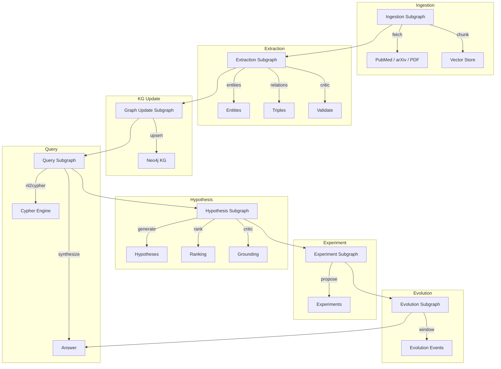

# ARA‑SKG

**Autonomous Research Assistant for Scientific Knowledge Graphs** — a
LangGraph-based framework that ingests biomedical literature, extracts
entities/relations into a scientific knowledge graph (KG), answers
natural-language queries, generates provenance-grounded hypotheses, proposes
experiments, and tracks concept evolution.

[](https://github.com/Firas-Althobaiti/ara-skg/actions/workflows/ci.yml)
[](https://www.python.org/)
[](LICENSE)
[](https://firas-althobaiti.github.io/ara-skg/)

> 📖 **Full documentation: <https://firas-althobaiti.github.io/ara-skg/>**
> (quickstart, architecture + ADRs, prompt catalog — deployed automatically
> from `main` via GitHub Actions)

## What's inside

Seven LangGraph subgraphs behind one supervisor, all sharing a typed
`ARAState`:

| Subgraph | One-liner |
|---|---|
| **Ingestion** | fetch papers (PubMed / arXiv / PDF / mock) → chunk → vector store |
| **Extraction** | entities → relations → entity linking → triple validation (with provenance) |
| **Graph update** | resolve canonical IDs → schema → upsert into the KG (human-approved via interrupt) |
| **Query** | guarded read-only NL→Cypher + evidence-backed answers |
| **Hypothesis** | generate 3–5 hypotheses → ground in ≥ 2 triples → rank → critique |
| **Experiment** | propose + feasibility-validate an experiment for the top hypothesis |
| **Evolution** | diff KG windows: emerging / fading / renamed / relation_shift events |

Plus two interchangeable KG backends (offline **NetworkX/JSON** and **Neo4j**),
a `typer` CLI (`ara`), a one-command offline demo, and an **evaluation harness**
(`make eval`).

## Install

Requires **Python 3.11+** (developed and CI-tested on 3.11–3.13; docs build on
3.13):

```bash
git clone https://github.com/Firas-Althobaiti/ara-skg.git
cd ara-skg
pip install -e .[dev]     # or: make install
# optional extras:
pip install -e .[eval]    # pandas/tabulate for eval analysis
pip install -e .[docs]    # mkdocs + material for the docs site
```

## Quickstart

```bash
make demo           # one-command end-to-end demo — fully offline, exits 0
make eval           # evaluation metrics table (see below)
```

👉 Full 5-minute walkthrough: **[docs/quickstart](https://firas-althobaiti.github.io/ara-skg/quickstart/)**

`make demo` runs `python scripts/demo.py`:

```text
3 mock papers → extract entities/relations → validate → upsert into the KG
    → generate 3 hypotheses → ground → rank → critique
    → propose 1 experiment → validate feasibility
    → evolution diff (current window vs. previous) → report
```

It prints rich tables to the console and writes **`artifacts/demo_report.md`**
(plus the persisted graph `artifacts/demo_kg.json`). It uses the **NetworkX
backend + mocked LLM**, so it needs **no API key and no Neo4j**.

### Demo output (condensed ASCII of the real console output)

```text
┌──────────────── ARA‑SKG end-to-end demo (NetworkX backend, mocked LLM) ─────────────────┐
                       1) Ingested papers (mock corpus)
┌───────────┬────────┬──────────────────────────────────────────┬──────┬────────┐
│ ID        │ Source │ Title                                    │ Year │ Chunks │
├───────────┼────────┼──────────────────────────────────────────┼──────┼────────┤
│ PMID:1001 │ mock   │ BRCA1 germline mutations and DNA repair… │ 2024 │      1 │
│ PMID:1002 │ mock   │ PARP inhibition with olaparib in BRCA…   │ 2024 │      1 │
│ PMID:1003 │ mock   │ TP53 regulation of BRCA1 and tamoxifen…  │ 2024 │      1 │
└───────────┴────────┴──────────────────────────────────────────┴──────┴────────┘
                     2) Extracted triples → KG
┌───────────┬─────────────────┬───────────────┬───────┬───────────┐
│ Subject   │ Predicate       │ Object        │ Conf. │ Paper     │
├───────────┼─────────────────┼───────────────┼───────┼───────────┤
│ BRCA1     │ associated_with │ Breast cancer │  0.90 │ PMID:1001 │
│ BRCA1     │ regulates       │ RAD51         │  0.90 │ PMID:1001 │
│ RAD51     │ involved_in     │ DNA repair    │  0.90 │ PMID:1001 │
│ Olaparib  │ inhibits        │ PARP1         │  0.90 │ PMID:1002 │
│ …         │ …               │ …             │  …    │ …         │
└───────────┴─────────────────┴───────────────┴───────┴───────────┘
┌────────────────────────────── 3) KG upsert ──────────────────────────────┐
│ added=9  updated=0  KG now: 8 nodes / 9 edges                            │
└──────────────────────────────────────────────────────────────────────────┘
                       4) Hypotheses (grounded + ranked)
┌───────┬─────────────────────────────────────────┬─────────┬────────┬────────┐
│ ID    │ Statement                               │ Novelty │ Plaus. │ #Supp. │
├───────┼─────────────────────────────────────────┼─────────┼────────┼────────┤
│ hyp_0 │ BRCA1 associated_with Breast cancer (…) │    0.95 │   0.60 │      6 │
│ hyp_1 │ BRCA1 regulates RAD51 (…)               │    0.80 │   0.70 │      4 │
│ hyp_2 │ RAD51 involved_in DNA repair (…)        │    0.65 │   0.80 │      3 │
└───────┴─────────────────────────────────────────┴─────────┴────────┴────────┘
critique: All hypotheses are well supported.
         5) Proposed experiment (top hypothesis)
┌───────────────────┬───────────────────────────────────┐
│ Field             │ Value                             │
├───────────────────┼───────────────────────────────────┤
│ id                │ exp_hyp_0                         │
│ hypothesis_id     │ hyp_0                             │
│ assay             │ cell_line_treatment               │
│ readouts          │ viability, target_phosphorylation │
│ …                 │ …                                 │
└───────────────────┴───────────────────────────────────┘
       6) Evolution events (current window vs. previous)
┌────────────────┬───────────┬────────┬─────────────────┐
│ Type           │ Entity    │ Before │ After           │
├────────────────┼───────────┼────────┼─────────────────┤
│ emerging       │ BRCA1     │        │ associated_with │
│ emerging       │ BRCA1     │        │ regulates       │
│ emerging       │ RAD51     │        │ involved_in     │
│ …              │ …         │  …     │ …               │
└────────────────┴───────────┴────────┴─────────────────┘
┌─────────────────────────────────────── Done ───────────────────────────────────────┐
│ Report written to …\ara-skg\artifacts\demo_report.md                              │
└────────────────────────────────────────────────────────────────────────────────────┘
```

### CLI

`pip install -e .` installs the `ara` command (entry point `ara.cli:main`):

| Command | What it does |
|---|---|
| `ara ingest "demo biomedical corpus"` | fetch (mock/pubmed/arxiv/pdf) → extract → resolve → upsert into the KG |
| `ara query "Which entities are in the KG?"` | guarded NL→Cypher query + synthesized answer |
| `ara hypothesize` | generate + ground + rank hypotheses from the current KG |
| `ara evolve all` | diff the current KG window against the previous snapshot |
| `ara demo` | the full end-to-end demo (same as `make demo`) |

All commands default to the offline **NetworkX** backend and the **mocked
LLM** — no API key needed. `--kg-store PATH` selects the JSON store;
`ARA_KG_BACKEND=neo4j` switches to Neo4j (see `.env.example`).

## Evaluation

Two modes, measuring different things — see
[docs/eval-methodology.md](docs/eval-methodology.md) for the full story.

```bash
make eval        # mock mode — regression gate, runs in CI (offline, free)
make eval-live   # live mode — real LLM, MANUAL only, needs OPENAI_API_KEY
```

| mode              | F1     | precision | recall | distractor_rejection | n_predicted |
|-------------------|--------|-----------|--------|----------------------|-------------|
| mock (CI)         | 0.9333 | —         | —      | —                    | —           |
| live v1.1.0       | 0.3056 | 0.2115    | 0.5500 | 1.0000               | 52          |
| live v1.2.0       | 0.3636 | 0.3333    | 0.4000 | 1.0000               | 24          |
| live v1.3.0       | 0.3636 | 0.3333    | 0.4000 | 1.0000               | 24          |

v1.2.0 doubles precision (+58%) and halves over-prediction by
capping relations per abstract at 6. F1 improved from 0.31 to 0.36,
still below our 0.5 target. The recall drop (0.55→0.40) is the cost
of the cap. v1.3.0 adds LLM-judge matching for semantic triple
equivalence; measured live it does not move F1 (0.3636, judge fired
once and accepted a pair that changed nothing) — and a one-shot
gpt-4o run (no cache, ~$0.04) also scored 0.3636, so the gap is
entity-level relation selection under the cap, not predicate
matching or model size. We publish these numbers as-is rather than
hide behind the 0.93 mock score, which measures a deterministic
parser against strings it produced.

- **extraction_f1** — F1 of the extraction pipeline vs. gold triples
  (`ara/eval/gold/real_abstracts.jsonl`, 20 hand-verified triples; curation
  rules in `ara/eval/gold/README.md`). Matching: predicate exact, entity
  names fuzzy (token Jaccard ≥ 0.5).
- **grounding** — fraction of hypotheses with ≥ 2 provenance-linked
  supporting triples.
- **distractor_rejection** — fraction of near-miss triples
  (`gold/distractors.jsonl`: right entities/wrong predicate, or reversed)
  the extractor did *not* emit.

## Configuration

All settings come from environment variables (see `.env.example`):
`OPENAI_API_KEY`, `NEO4J_URI` / `NEO4J_USER` / `NEO4J_PASSWORD`,
`ARA_KG_BACKEND` (`networkx` default, or `neo4j`), `ARA_KG_STORE` (JSON path
for the NetworkX backend), `VECTOR_DIR`, and the optional LangSmith vars.

## Development

```bash
make lint        # ruff + black
make type        # mypy --strict ara
make test        # pytest (119 tests)
make cov         # pytest --cov=ara
make eval        # evaluation metrics
make demo        # offline end-to-end demo
make docs        # mkdocs serve (pip install -e .[docs] first)
make docs-build  # mkdocs build --strict
```

Optional — real Neo4j backend with a seeded KG:

```bash
make up     # docker compose up -d   (Neo4j)
make seed   # python scripts/seed_neo4j.py — 30-triple biomedical seed (idempotent)
```

## Roadmap → v1.4+

v1.3.0 shipped LLM-judge matching; live F1 is honestly 0.3636 on both
gpt-4o-mini and gpt-4o (see [Evaluation](#evaluation) and
[docs/eval-methodology.md](docs/eval-methodology.md)). Next:

- Bigger gold set (50–100 triples from curated papers) — reduces n=20 noise
- Neo4j read-only enforcement (deferred from v1.1)
- (gpt-4o reason-tier pass: measured, no F1 gain at ~10× cost — not planned)

## Architecture (Mermaid)



Full details + decision records: [Architecture & ADRs](https://firas-althobaiti.github.io/ara-skg/architecture/).

## License

MIT — see [LICENSE](LICENSE).
