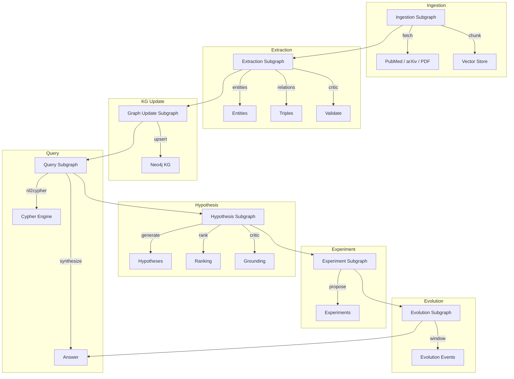

# ARA‑SKG

**Autonomous Research Assistant** — a LangGraph-based framework that ingests
biomedical literature, extracts entities/relations into a scientific
knowledge graph (KG), answers natural-language queries, generates grounded
hypotheses, proposes experiments, and tracks concept evolution.

## Quickstart

```bash
git clone https://github.com/Firas-Althobaiti/ara-skg.git
cd ara-skg
make install        # == pip install -e .[dev]
make demo           # one-command end-to-end demo — fully offline, exits 0
```

`make demo` runs `python scripts/demo.py`:

```
3 mock papers → extract entities/relations → validate → upsert into the KG
    → generate 3 hypotheses → ground → rank → critique
    → propose 1 experiment → validate feasibility
    → evolution diff (current window vs. previous) → report
```

It prints rich tables to the console and writes **`artifacts/demo_report.md`**
(plus the persisted graph `artifacts/demo_kg.json`). It uses the **NetworkX
backend + mocked LLM**, so it needs **no API key and no Neo4j**.

Optional — real Neo4j backend with a seeded KG:

```bash
make up             # docker compose up -d   (Neo4j, see .github/docker-compose.yml)
make seed           # python scripts/seed_neo4j.py — 30-triple biomedical seed (idempotent:
                    # re-running reports added=0, updated=30)
```

### Demo output (condensed ASCII of the real console output)

```text
┌──────────────── ARA‑SKG end-to-end demo (NetworkX backend, mocked LLM) ─────────────────┐
                       1) Ingested papers (mock corpus)
┌───────────┬────────┬──────────────────────────────────────────┬──────┬────────┐
│ ID        │ Source │ Title                                    │ Year │ Chunks │
├───────────┼────────┼──────────────────────────────────────────┼──────┼────────┤
│ PMID:1001 │ mock   │ BRCA1 germline mutations and DNA repair… │ 2024 │      1 │
│ PMID:1002 │ mock   │ PARP inhibition with olaparib in BRCA…   │ 2024 │      1 │
│ PMID:1003 │ mock   │ TP53 regulation of BRCA1 and tamoxifen…  │ 2024 │      1 │
└───────────┴────────┴──────────────────────────────────────────┴──────┴────────┘
                     2) Extracted triples → KG
┌───────────┬─────────────────┬───────────────┬───────┬───────────┐
│ Subject   │ Predicate       │ Object        │ Conf. │ Paper     │
├───────────┼─────────────────┼───────────────┼───────┼───────────┤
│ BRCA1     │ associated_with │ Breast cancer │  0.90 │ PMID:1001 │
│ BRCA1     │ regulates       │ RAD51         │  0.90 │ PMID:1001 │
│ RAD51     │ involved_in     │ DNA repair    │  0.90 │ PMID:1001 │
│ Olaparib  │ inhibits        │ PARP1         │  0.90 │ PMID:1002 │
│ …         │ …               │ …             │  …    │ …         │
└───────────┴─────────────────┴───────────────┴───────┴───────────┘
┌────────────────────────────── 3) KG upsert ──────────────────────────────┐
│ added=9  updated=0  KG now: 8 nodes / 9 edges                            │
└──────────────────────────────────────────────────────────────────────────┘
                       4) Hypotheses (grounded + ranked)
┌───────┬─────────────────────────────────────────┬─────────┬────────┬────────┐
│ ID    │ Statement                               │ Novelty │ Plaus. │ #Supp. │
├───────┼─────────────────────────────────────────┼─────────┼────────┼────────┤
│ hyp_0 │ BRCA1 associated_with Breast cancer (…) │    0.95 │   0.60 │      6 │
│ hyp_1 │ BRCA1 regulates RAD51 (…)               │    0.80 │   0.70 │      4 │
│ hyp_2 │ RAD51 involved_in DNA repair (…)        │    0.65 │   0.80 │      3 │
└───────┴─────────────────────────────────────────┴─────────┴────────┴────────┘
critique: All hypotheses are well supported.
         5) Proposed experiment (top hypothesis)
┌───────────────────┬───────────────────────────────────┐
│ Field             │ Value                             │
├───────────────────┼───────────────────────────────────┤
│ id                │ exp_hyp_0                         │
│ hypothesis_id     │ hyp_0                             │
│ assay             │ cell_line_treatment               │
│ readouts          │ viability, target_phosphorylation │
│ …                 │ …                                 │
└───────────────────┴───────────────────────────────────┘
       6) Evolution events (current window vs. previous)
┌────────────────┬───────────┬────────┬─────────────────┐
│ Type           │ Entity    │ Before │ After           │
├────────────────┼───────────┼────────┼─────────────────┤
│ emerging       │ BRCA1     │        │ associated_with │
│ emerging       │ BRCA1     │        │ regulates       │
│ emerging       │ RAD51     │        │ involved_in     │
│ …              │ …         │  …     │ …               │
└────────────────┴───────────┴────────┴─────────────────┘
┌─────────────────────────────────────── Done ───────────────────────────────────────┐
│ Report written to …\ara-skg\artifacts\demo_report.md                              │
└────────────────────────────────────────────────────────────────────────────────────┘
```

The full markdown report (papers, triples, hypotheses, experiment, evolution)
lands in `artifacts/demo_report.md`.

### CLI

`pip install -e .` installs the `ara` command (entry point `ara.cli:main`):

| Command | What it does |
|---|---|
| `ara ingest "demo biomedical corpus"` | fetch (mock/pubmed/arxiv/pdf) → extract → resolve → upsert into the KG |
| `ara query "Which entities are in the KG?"` | guarded NL→Cypher query + synthesized answer |
| `ara hypothesize` | generate + ground + rank hypotheses from the current KG |
| `ara evolve all` | diff the current KG window against the previous snapshot |
| `ara demo` | the full end-to-end demo (same as `make demo`) |

All commands default to the offline **NetworkX** backend and the **mocked
LLM** — no API key needed. `--kg-store PATH` selects the JSON store;
`ARA_KG_BACKEND=neo4j` switches to Neo4j (see `.env.example`).

## Configuration

All settings come from environment variables (see `.env.example`):
`OPENAI_API_KEY`, `NEO4J_URI` / `NEO4J_USER` / `NEO4J_PASSWORD`,
`ARA_KG_BACKEND` (`networkx` default, or `neo4j`), `ARA_KG_STORE` (JSON path
for the NetworkX backend), `VECTOR_DIR`, and the optional LangSmith vars.

## Development

```bash
make lint   # ruff + black
make type   # mypy --strict ara
make test   # pytest (59 tests)
make cov    # pytest --cov=ara
```

## Architecture (Mermaid)


