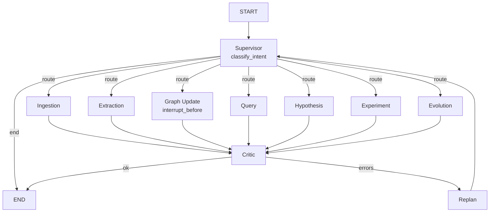

# Architecture

ARA-SKG is a **LangGraph** application: one main `StateGraph` that routes to
seven compiled subgraphs via a supervisor, with a critic/replan loop and a
SQLite checkpointer. All state flows through a single typed `ARAState`
(TypedDict in `ara/schemas/state.py`).

## Main graph

## The 7 subgraphs

| Subgraph | Nodes (in order) | Purpose |
|---|---|---|
| **Ingestion** | `route_sources → fetch_papers → chunk_papers → persist_chunks` (+ `error`) | Fetch from PubMed / arXiv / PDF / mock, chunk, persist to the vector store |
| **Extraction** | `extract_entities → extract_relations → link_entities → validate_triples` | Turn chunks into validated, provenance-tagged triples |
| **Graph update** | `resolve_triples → ensure_schema → upsert_kg` (+ `rollback_on_error`) | Canonical entity IDs, schema, KG upsert with rollback; **interrupted before execution for human approval** |
| **Query** | NL→Cypher → guard → run → synthesize | Guarded, read-only natural-language queries over the KG + vector evidence |
| **Hypothesis** | `generate → ground → rank → critique` | 3–5 testable hypotheses, grounded in ≥ 2 supporting triples, ranked by novelty + plausibility |
| **Experiment** | `propose → validate` | Propose a concrete experiment for the top hypothesis, validate feasibility |
| **Evolution** | `window → detect → summarize` | Diff the current KG window against the previous snapshot (emerging / fading / renamed / relation_shift) |

## KG backends

- **NetworkX** (default, offline): JSON-persisted `networkx.DiGraph`
  (`ara/clients/kg_networkx.py`), used by the demo and CLI.
- **Neo4j**: full Cypher via `ara/clients/neo4j.py` (`make up` + `make seed`).

Both implement the `KnowledgeGraphClient` protocol (`ara/clients/kg.py`).

## Architecture Decision Records

- [ADR-0001 — Subgraphs](adr/0001-subgraphs.md): why one subgraph per research phase
- [ADR-0002 — Checkpointer](adr/0002-checkpointer.md): SQLite checkpointer and resume semantics
- [ADR-0003 — Send fan-out](adr/0003-send-fanout.md): how per-chunk fan-out is handled
- [ADR-0004 — Interrupt before](adr/0004-interrupt-before.md): human-in-the-loop approval before KG writes
